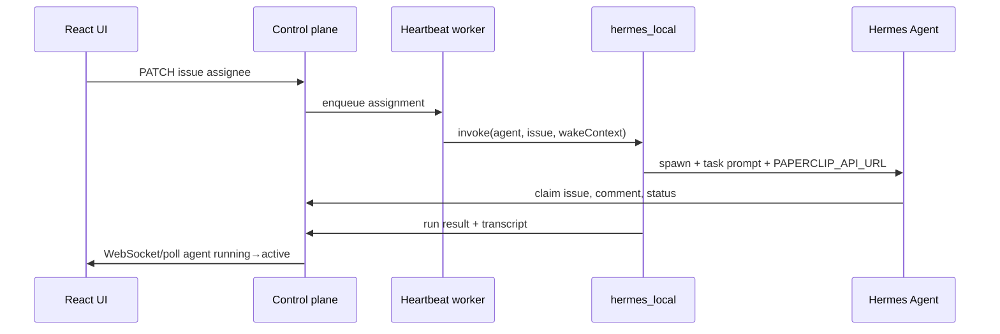

# Hermes-only Paperclip — Phase 0 MVP

상태: 2026-11-22  
선행: [paperclip-research.md](./paperclip-research.md), [hermes-paperclip.md](./hermes-paperclip.md)  
구현 위치: **별도 앱 레포** (Paperclip MIT 포크 권장). 이 `loop` repo는 스펙만.

## MVP 한 줄

**한 Company, CEO 에이전트 1명(Hermes), 태스크 배정 → 하트비트 1회 → Run 기록·대시보드에 반영**까지 Paperclip UI 플로우로 끝낸다.

## 성공 기준 (데모 시나리오)

1. 온보딩 또는 설정에서 Company(이름, 목표, 월 예산) 생성  
2. Agent hire: `adapterType = hermes_local` (또는 `hermes_gateway`), heartbeat 기본값 적용  
3. Task 생성 → CEO에 assign → **assignment heartbeat** 트리거  
4. Hermes가 턴 수행(최소: 이슈 상태·코멘트 1건 또는 설명 텍스트)  
5. Agent detail **Runs**에 transcript·상태(success/failed), Dashboard에 **Running → Active** 회복  

Phase 0에서 **필수 아님**: 승인 큐, Routines, Skills UI, Org chart, 멀티 어댑터, #460 Memory 탭.

## Hermes 런타임 고정

| 선택 | Phase 0 권장 | 이유 |
|------|----------------|------|
| **`hermes_local`** | **기본** | Paperclip이 프로세스 스폰·`persistSession`·환경 검사까지 문서화됨 |
| **`hermes_gateway`** | 옵션(2대 PC/팀 공유 Hermes) | `sessionKeyStrategy: issue`, `POST /v1/runs` + SSE |

**제품 플래그 (포크 시):** `ADAPTER_ALLOWLIST=hermes_local,hermes_gateway` — UI Harness 드롭다운·Settings → Adapters에 Hermes만 노출.

**전제 (공식 Paperclip Hermes):**

- 로컬: `pip install hermes-agent`, Python 3.10+, `~/.hermes/config.yaml` 모델/프로바이더  
- Gateway: `apiBaseUrl` + `apiKey` (Hermes `API_SERVER_KEY`)

> README의 `hermes-acp`(Buzz 연구)와 **문서상 어댑터 키는 다름**. 카피캣 1차는 Paperclip **`hermes_*`** 계약을 따르고, ACP 래퍼가 필요하면 Phase 1에서 `process`/`http` 어댑터 또는 Runner 확장으로 별도 스펙.

### Hermes 어댑터 — Phase 0 설정

```yaml
# Agent runtimeConfig (Advanced → YAML)
runtimeConfig:
  adapterType: hermes_local   # 또는 hermes_gateway
  heartbeat:
    enabled: false
    intervalSec: 300
    wakeOnDemand: true
    skipTimerWhenNoActionableWork: true
    cooldownSec: 10
    maxConcurrentRuns: 3
  hermes:
    persistSession: true
    quiet: true
    timeoutSec: 1800
    # gateway only:
    # apiBaseUrl: https://hermes.example/api
    # sessionKeyStrategy: issue
```

## Phase 0 데이터 모델 (최소 엔티티)

| 엔티티 | 필드(핵심) | Paperclip 격리 |
|--------|------------|----------------|
| **Company** | `id`, `name`, `goal`, `monthlyBudgetCents` | 루트 tenant |
| **Agent** | `id`, `companyId`, `title`, `managerId?`, `adapterType`, `runtimeConfig`, `status`, `monthlyBudgetCents?` | company-scoped |
| **Issue (Task)** | `id`, `identifier`, `title`, `description`, `status`, `assigneeAgentId?`, `checkoutByRunId?`, `priority` | company-scoped |
| **Run** | `id`, `agentId`, `issueId?`, `trigger`, `status`, `startedAt`, `endedAt`, `transcript`, `usage`, `error` | company-scoped |
| **ActivityEvent** | `id`, `companyId`, `type`, `entityRef`, `createdAt` | feed용 (최소 타입만) |

**Issue 상태머신 (Phase 0):**

```
backlog | todo → in_progress → in_review → done
         └→ blocked, cancelled
```

- **Checkout:** assignee가 run 시작 시 issue lock; 다른 agent run은 claim 실패  
- Phase 0: `in_review` / 서브태스크 트리 **UI 생략 가능**, API enum은 유지 권장(포크 호환)

## Phase 0 API 서브셋 (OpenAPI / 포크 기준)

Paperclip 전체 API 중 MVP가 **읽고 쓰는** 엔드포인트. 이름은 Paperclip docs [API reference](https://docs.paperclip.ing/) 패턴을 따른다.

### Company

| Method | Path | UI / 백엔드 |
|--------|------|-------------|
| `POST` | `/api/companies` | 온보딩 |
| `GET` | `/api/companies/:id` | 레이아웃, 설정 |
| `PATCH` | `/api/companies/:id` | 목표·예산 |

### Agents

| Method | Path | UI / 백엔드 |
|--------|------|-------------|
| `POST` | `/api/companies/:companyId/agents` | New Agent (Hermes only) |
| `GET` | `/api/companies/:companyId/agents` | `/agents/all`, Dashboard 카드 |
| `GET` | `/api/agents/:id` | Agent detail Overview |
| `PATCH` | `/api/agents/:id` | Identity, Advanced YAML |
| `POST` | `/api/agents/:id/wake` | Run now (on-demand heartbeat) |
| `GET` | `/api/agents/:id/runs` | Audit → Runs |
| `GET` | `/api/agents/:id/runs/:runId` | Run transcript |

### Issues (Tasks)

| Method | Path | UI / 백엔드 |
|--------|------|-------------|
| `POST` | `/api/companies/:companyId/issues` | Task 생성 |
| `GET` | `/api/companies/:companyId/issues` | `/issues` 리스트 (+ `?status=`) |
| `GET` | `/api/issues/:id` | Task detail |
| `PATCH` | `/api/issues/:id` | 상태, assignee |
| `POST` | `/api/issues/:id/comments` | (선택) 코멘트 → comment-triggered heartbeat |

### Runs / Heartbeat (내부)

| 구성요소 | 역할 |
|----------|------|
| **Heartbeat scheduler** | assignment, wake, (선택) timer 이벤트 큐 |
| **Adapter runner** | `hermes_local` spawn / `hermes_gateway` HTTP |
| **Agent-facing API** | run 중 Hermes가 호출: list assigned issues, claim, patch status (Paperclip skill/프롬프트에 URL·`PAPERCLIP_API_KEY`) |

Phase 0 **비포함 API:** approvals, routines, skills CRUD, connections, plugins, org-chart, memories.

## 화면 ↔ API ↔ Hermes 매핑

### 1. Dashboard `/`

| UI 위젯 | 데이터 소스 | Phase 0 |
|---------|-------------|---------|
| Agents Enabled (active/running/error/paused) | `GET .../agents` + run 상태 집계 | **필수** |
| Tasks In Progress | `GET .../issues?status=in_progress` + open count | **필수** |
| Month Spend | cost 집계 | **스텁 OK** (0 또는 usage placeholder) |
| Pending Approvals | approvals API | **숨김 또는 0 고정** |
| Recent Activity (10) | activity feed | **필수** (issue/run 이벤트만) |
| Recent Tasks | `GET issues` sort `updatedAt` | **필수** |
| 14일 차트 | runs 시계열 | **선택** (빈 차트 허용) |

### 2. Tasks `/issues`

| UI | API | Phase 0 |
|----|-----|---------|
| 테이블 + Status/Assignee 필터 | `GET .../issues` | **필수** |
| New task | `POST .../issues` | **필수** |
| Assign to agent | `PATCH .../issues` | **필수** (→ heartbeat) |
| Inbox tabs (Mine/Blocked/…) | 동일 issues + view query | **선택** (All + assignee 필터로 대체 가능) |

### 3. Agents `/agents/all`

| UI | API | Phase 0 |
|----|-----|---------|
| 리스트 + 상태 배지 | `GET .../agents` | **필수** |
| New Agent | `POST .../agents` (`hermes_local` 고정) | **필수** |
| Run now (⋯) | `POST .../agents/:id/wake` | **필수** |
| Bulk adapter edit | - | **제거** (Hermes only) |

### 4. Agent detail `/agents/:id`

| 탭 | API / 동작 | Phase 0 |
|----|------------|---------|
| **Overview** | agent + 최근 run 요약 | **필수** |
| **Identity** | `PATCH` title, manager | **필수** (CEO 1명이면 manager 생략) |
| **Advanced** | `runtimeConfig` YAML (heartbeat) | **필수** (읽기 전용 기본값도 OK) |
| **Harness/Runtime** | adapter config, Run test | **필수** (`hermes_local` env test) |
| **Instructions** | AGENTS.md / system prompt blob | **선택** (단일 textarea) |
| **Skills** | skills API | **숨김** |
| **Audit → Runs** | `GET .../runs` | **필수** |
| **Audit → Activity/Costs/Budgets** | - | Costs/Budgets **스텁**, Activity **최소** |

### 5. Settings → Adapters

| UI | Phase 0 |
|----|---------|
| Built-in list | **Hermes 2종만** 표시 |
| External adapters | **빈 상태** |

## Heartbeat 파이프라인 (Phase 0)



**트리거 (Phase 0 구현 순서):**

1. **On demand** — `POST .../wake`  
2. **Assignment** — issue assignee 변경  
3. **Comment** — (선택) 담당 issue에 comment  
4. **Timer** — `heartbeat.enabled: true` 일 때만  

**Wake context (adapter에 전달):** `companyId`, `agentId`, `issueId?`, `trigger`, `paperclipApiUrl`, task title/description.

**Run 종료:** success / failed / timeout; failed 시 Overview error 배지 + Runs transcript.

## 영속 맥락 (Phase 0 — #460 대체)

| 메커니즘 | 용도 |
|----------|------|
| `persistSession: true` + Hermes `--resume` | 같은 agent 연속 wake (agent-scoped) |
| Gateway `sessionKeyStrategy: issue` | 태스크별 격리 (권장) |
| Paperclip DB `agent_memories` | **Phase 0 없음** |

## 포크 구현 체크리스트 (엔지니어링)

**Week 0 — 포크 부팅**

- [ ] `paperclipai/paperclip` 클론, 로컬 Postgres, `pnpm`/`npm` dev 서버  
- [ ] 플래그: non-Hermes 어댑터 UI 숨김 + hire 마법사 Hermes 기본값  
- [ ] Hermes env test (Python/pip) 통과

**Week 1 — Phase 0 수직 슬라이스**

- [ ] Company + CEO agent + 1 issue + assignment wake  
- [ ] Runs UI에 transcript  
- [ ] Dashboard 카드 4종 (approvals 0)

**Week 2 — 마무리**

- [ ] Run now, 실패 transcript, agent error 상태  
- [ ] README (포크): Hermes-only, loop 문서 링크  
- [ ] (선택) Docker compose + seed script

## 수용 테스트

| # | Given | When | Then |
|---|--------|------|------|
| T1 | Hermes 미설치 | Hire agent + Run test | 명확한 설치 안내, run 미시작 |
| T2 | CEO + assigned issue | Assign 트리거 | Run 1건 생성, issue `in_progress` 또는 comment 존재 |
| T3 | Run 실패(타임아웃) | 완료 | Agent error, Runs에 stderr/transcript |
| T4 | Dashboard | 새 run 후 | Running 카운트 일시 증가 후 복귀 |
| T5 | Settings → Adapters | 조회 | Claude/Codex 등 **미표시**, Hermes만 |

## Phase 0 이후 (문서만 참고)

| Phase | 추가 |
|-------|------|
| **1** | Approvals(전략/hire), comments, Inbox Mine, per-agent budget pause, activity types 확장 |
| **2** | Skills, Connections, Org chart, Memory (#460 패리티) |

## 참고

- [Hermes adapter](https://docs.paperclip.ing/reference/adapters/hermes/)  
- [Hermes Gateway](https://docs.paperclip.ing/reference/adapters/hermes-gateway/)  
- [Agents / heartbeats](https://docs.paperclip.ing/guides/org/agents/)  
- [Dashboard](https://docs.paperclip.ing/guides/day-to-day/dashboard/)  
- [Issues](https://docs.paperclip.ing/guides/day-to-day/issues/)